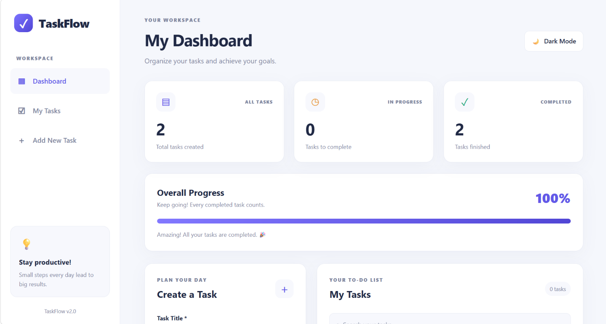
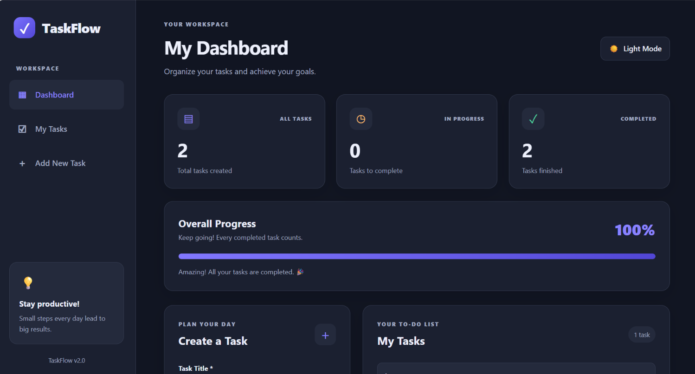

# TaskFlow – Task Manager

A responsive task management web app built with HTML, CSS and vanilla JavaScript.

🔗 **Live Demo:** [https://sandhiya-s21.github.io/taskflow-task-manager/](https://sandhiya-s21.github.io/taskflow-task-manager/)

## Features
- Add, edit, delete and complete tasks
- Priority levels (Low / Medium / High) and due dates with overdue highlighting
- Search and filter (All / Pending / Completed)
- Dashboard stats and overall progress bar
- Light / Dark mode
- Data saved in the browser using localStorage
- Fully responsive layout

## Tech Stack
HTML5 · CSS3 (Grid, Flexbox, CSS variables) · JavaScript (ES6)

## Run Locally
1. Clone the repo:
   ```bash
   git clone https://github.com/Sandhiya-S21/taskflow-task-manager.git
   ```
2. Open `index.html` in your browser

## Output

| Light Mode | Dark Mode |
|:---:|:---:|
|  |  |

📁 See all screenshots in the [output folder](output/).

## Future Improvements
- Sort by due date / priority
- Drag and drop reordering
- Task categories and reminders
